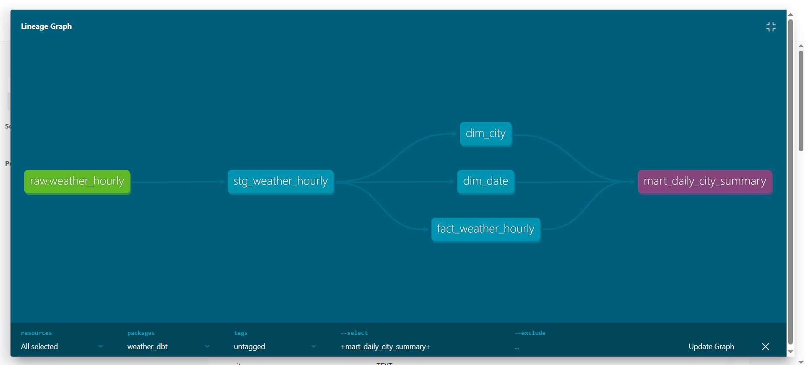

# Weather Data Pipeline: Airflow → Snowflake → dbt

An end-to-end batch pipeline that loads one year of hourly weather for 20 cities (175,200 rows) into Snowflake and models it into a star schema with dbt.

## Architecture

```text
Open-Meteo Archive API
        │  (Airflow: extract_hourly)
        ▼
  weather_hourly.csv
        │  (Airflow: load_hourly — PUT + COPY INTO stage, then MERGE)
        ▼
Snowflake  RAW.WEATHER_HOURLY
        │  (dbt)
        ▼
stg_weather_hourly (view)
        ├─► dim_city
        ├─► dim_date
        └─► fact_weather_hourly (incremental, merge)
                    │
                    ▼
        mart_daily_city_summary
```



## What it does

- **Extract:** pulls hourly temperature, precipitation, humidity and wind speed for 10 Pakistani and 10 international cities (8,760 hours each) from the Open-Meteo archive API, with retries.
- **Load:** bulk-loads the file with `PUT` and `COPY INTO` a staging table, then runs one `MERGE` on (city, timestamp). Re-running never creates duplicates.
- **Model:** dbt builds a staging view, two dimensions, an incremental fact table and a daily summary mart (7,300 rows: 20 cities × 365 days).
- **Test:** 11 dbt tests pass: unique and not-null keys, relationships from the fact table to both dimensions, a temperature range check, and a check that the fact table has no duplicate city-hour rows.

## Design decisions

- **Bulk load instead of row-by-row `MERGE`:** my first version issued one `MERGE` per row, which does not scale to 175K rows, so the load uses a stage and a single `MERGE`.
- **Incremental fact table:** `fact_weather_hourly` merges on (city_key, observed_at) and only reads the last 3 days of source data after the first run, so late corrections are picked up without full rebuilds.
- **Least-privilege access:** the pipeline runs as a dedicated Snowflake user and role, not the admin account.

## Tech stack

Python, Apache Airflow (Docker Compose, LocalExecutor), Snowflake, dbt Core, SQL

## Run it

1. In Snowflake, create the warehouse, database, `RAW` schema, a role and a user for the pipeline.
2. Create a `.env` file (never commit it) with `SNOWFLAKE_USER`, `SNOWFLAKE_PASSWORD`, `SNOWFLAKE_ACCOUNT` and the Airflow keys.
3. Start Airflow: `docker compose up airflow-init`, then `docker compose up -d`.
4. Trigger the `weather_hourly_to_snowflake` DAG once.
5. Configure `~/.dbt/profiles.yml` for Snowflake, then from `weather_dbt/` run `dbt run`, `dbt test` and `dbt docs generate`.

## Project structure

```text
dags/                  Airflow DAGs and the extract script
weather_dbt/models/    staging and marts (star schema)
weather_dbt/tests/     custom data tests
docker-compose.yaml    Airflow stack
```

## Next steps

- Trigger `dbt run` and `dbt test` from Airflow after each load.
- Switch the DAG to a daily schedule with a short lookback window.