# Build walkthrough: Airflow → Snowflake → dbt → Power BI

This is the long version of the project: how I built it, what broke, how I fixed it, and what the results look like. The short overview is in the [README](../README.md).

## The pipeline in one paragraph

An Airflow DAG pulls one year of hourly weather for 20 cities from the Open-Meteo archive API, bulk-loads it into Snowflake, builds a dbt star schema on top, and runs the dbt tests. Power BI reads the final summary table.

```text
Open-Meteo API → extract_hourly → load_hourly → dbt_run → dbt_test → Power BI
```

---

## 1. Snowflake setup

- Created an XSMALL warehouse with a 60-second auto-suspend, a database (`WEATHER_DB`) and a `RAW` schema.
- Created a dedicated role (`PIPELINE_ROLE`) and a service user (`AIRFLOW_USER`) for the pipeline, instead of running everything as the admin account. The role only has access to this project's warehouse and database.

## 2. Extract and load (Airflow)

- **Extract:** calls the Open-Meteo archive API for 20 cities (10 in Pakistan, 10 elsewhere), pulling hourly temperature, precipitation, humidity and wind speed for 365 days (2025-11-01 to 2026-10-31). It retries on API errors and waits a second between calls.
- **Load:** uploads the CSV to a Snowflake stage, runs `COPY INTO` a staging table, then runs a single `MERGE` into `RAW.WEATHER_HOURLY` on (city, timestamp). Rerunning the load updates existing rows instead of duplicating them.

Row counts after the first load: 175,200 rows, which is 20 cities × 8,760 hours.

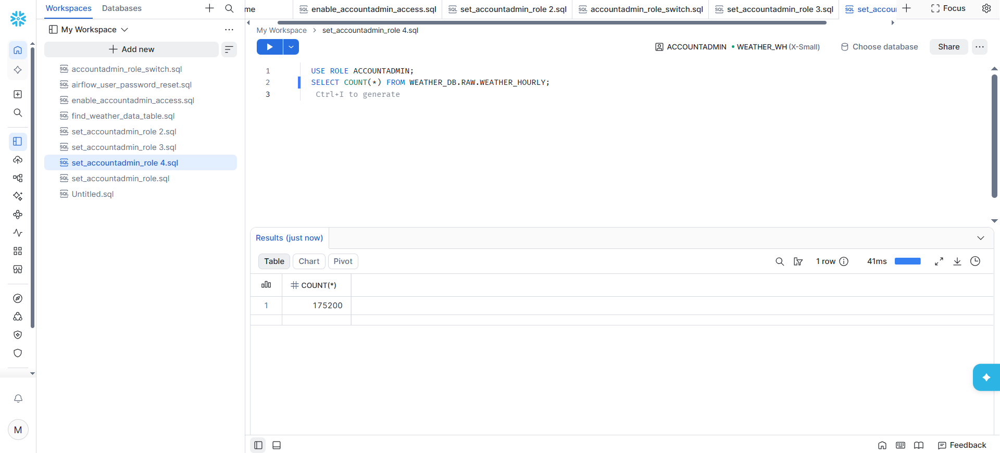

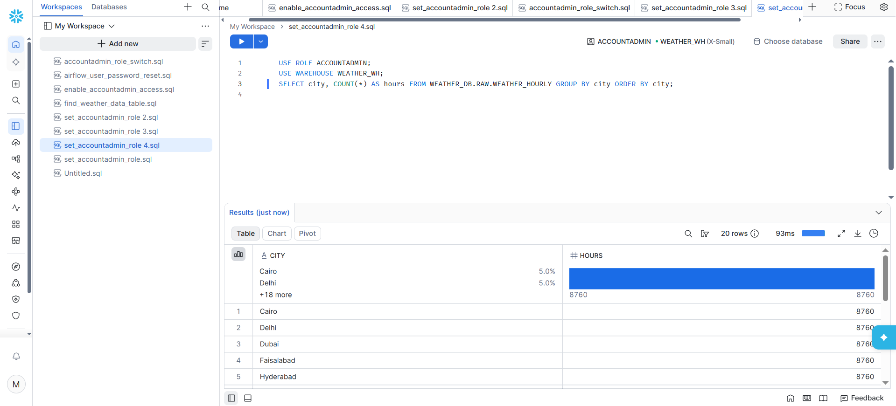

## 3. dbt models

| Model | Type | What it is |
|---|---|---|
| `stg_weather_hourly` | view | Renames and cleans the raw columns |
| `dim_city` | table | One row per city (20) |
| `dim_date` | table | One row per day (365) |
| `fact_weather_hourly` | incremental table | One row per city per hour. Merges on (city, hour) and only reads the last 3 days of source data after the first run |
| `mart_daily_city_summary` | table | Daily averages, highs, lows and rainfall per city (7,300 rows) |

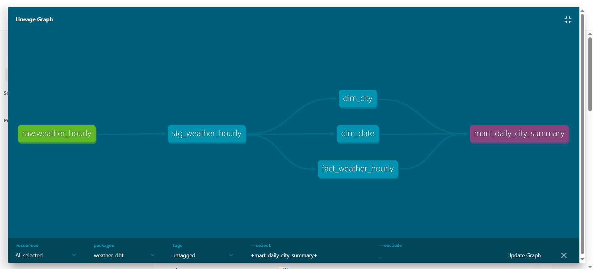

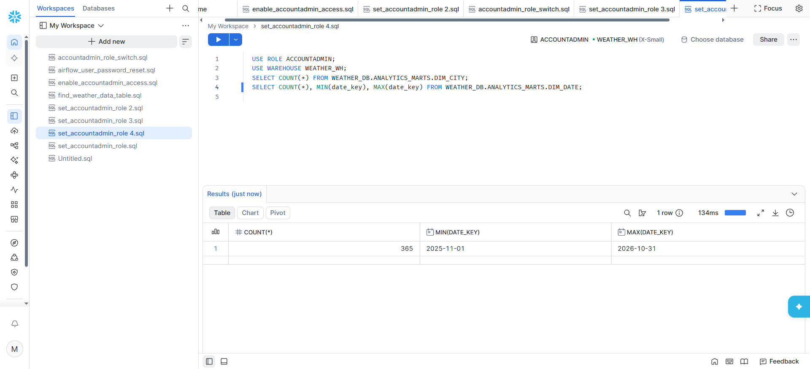

## 4. Tests

11 dbt tests, all passing:

- `unique` and `not_null` on the keys of `dim_city` and `dim_date`
- `relationships` from the fact table to both dimensions, so every fact row points to a real city and a real date
- a custom test that fails on impossible temperatures (below -60 °C or above 60 °C)
- a custom test that fails if the fact table has more than one row for the same city and hour

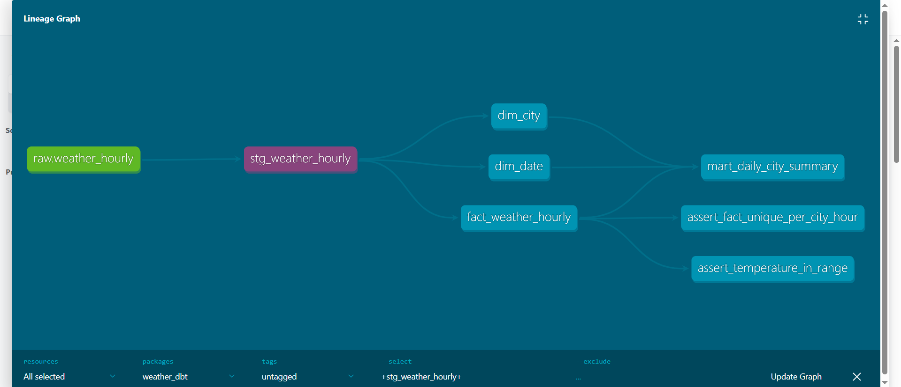

## 5. Orchestration

One DAG, `weather_hourly_to_snowflake`, with four tasks: `extract_hourly → load_hourly → dbt_run → dbt_test`. dbt runs from its own virtual environment inside a custom Airflow image, so its packages cannot clash with Airflow's. If a test fails, the last task turns red.

A full run takes about two and a half minutes on my laptop.

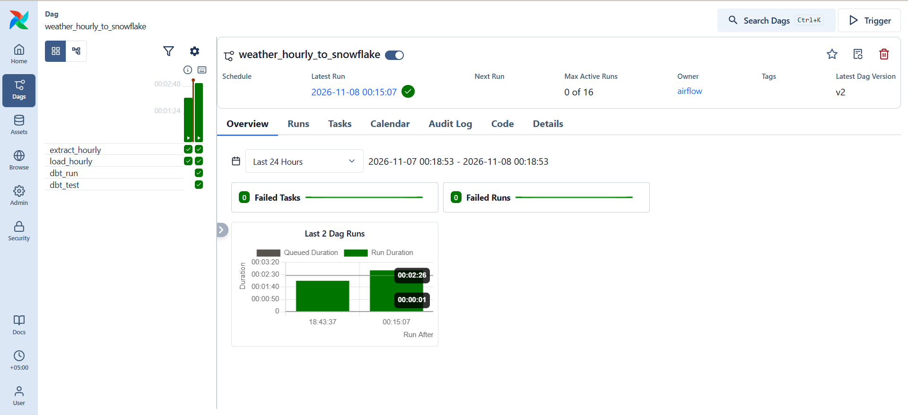

After the second run, the fact table still has 175,200 rows, so the pipeline is safe to rerun.

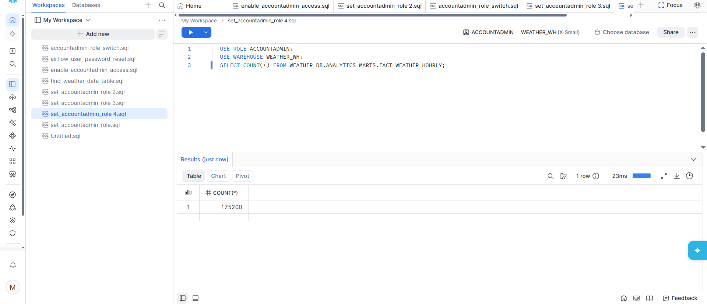

## 6. Dashboard

A Power BI report on top of `mart_daily_city_summary`, built with five DAX measures (average, maximum and minimum temperature, total rainfall, average humidity). A country slicer filters every visual.


---

## Results

| Check | Result |
|---|---|
| Raw rows loaded | 175,200 (20 cities × 8,760 hours) |
| Date range | 2025-11-01 to 2026-10-31 (365 days) |
| Fact table after a rerun | 175,200, no duplicates |
| Daily summary rows | 7,300 (20 cities × 365 days) |
| dbt tests | 11 of 11 passing |
| Hottest day in the data | Hyderabad, 46.6 °C on 2026-06-11 |
| Full pipeline run | about 2.5 minutes |

Average yearly temperature by country ranged from about 9 °C to 28.5 °C, with the UAE, Singapore and India at the top.

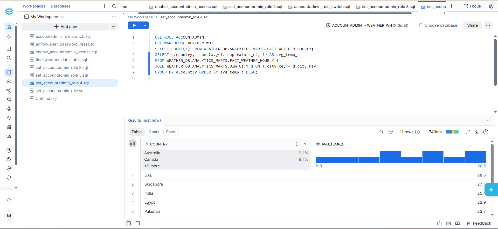

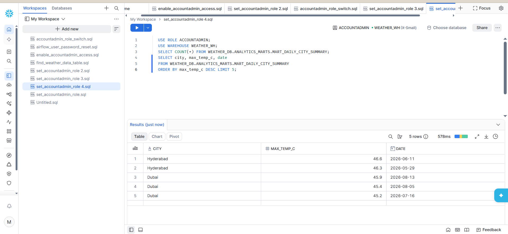

---

## Problems I hit and how I fixed them

| Problem | Cause | Fix |
|---|---|---|
| The pipeline could not log in to Snowflake with my own account | Snowflake requires MFA for normal user logins, and a script cannot answer an MFA prompt | Created a separate service user (`AIRFLOW_USER`) with its own least-privilege role |
| `AIRFLOW_USER` got locked | Old DAG runs kept retrying with a wrong password, and Snowflake locks a user after repeated failures | Paused the DAG and deleted the old runs, unlocked the user, recreated it with a new password, and tested the login once outside Airflow before restarting anything |
| "Session does not have a current database" | The new role had no privileges, because I ran four `GRANT` statements as one block and the worksheet only runs one statement at a time | Ran each grant on its own and checked with `SHOW GRANTS` |
| I could not query a table the pipeline had just created | The table was owned by `PIPELINE_ROLE`, which the admin role did not inherit | Granted `PIPELINE_ROLE` to the admin role |
| Tasks stuck in "queued", and the worker and triggerer were unhealthy | The Celery setup (8 containers) was too heavy for my laptop, and Airflow's 94 example DAGs kept the DAG processor at about 170% CPU | Switched to `LocalExecutor` and turned off the example DAGs |
| The custom Airflow image hung for 25 minutes while installing dbt | pip chose the newest version of one dependency, which only ships source code, so it tried to compile a Rust package on my laptop | Installed with `--only-binary=:all:` so only prebuilt packages are used |
| Docker's engine stopped responding after the aborted build | The Docker storage disk was left locked by the interrupted build | Restarted Docker. My code and `.env` live outside Docker's storage, so nothing was lost |
| A Power BI card showed 8.3K for average temperature | The card used the raw column, which Power BI sums by default | Replaced it with a DAX measure (`AVERAGE`), and used measures for every number in every visual |
| All my commits landed as one | Files were already staged from an earlier `git add .`, so every commit took all of them | Reset the commit, unstaged everything, and recommitted in separate, labeled commits |

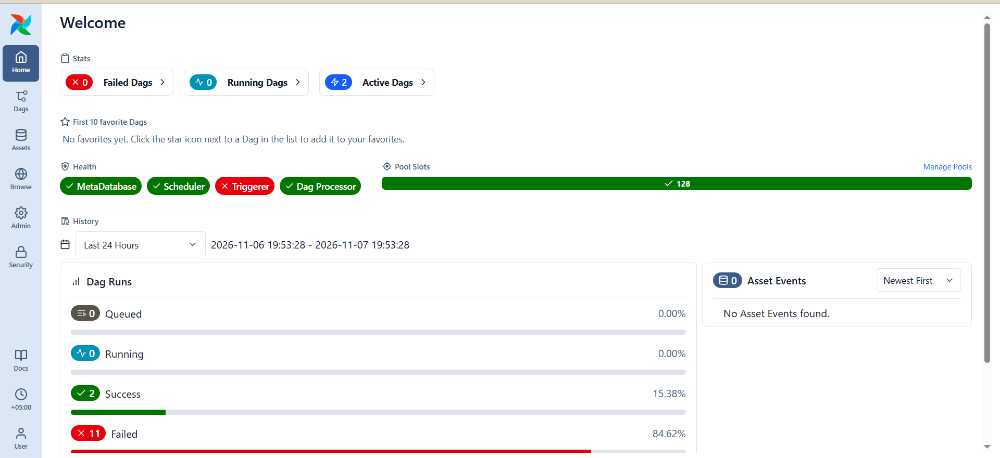

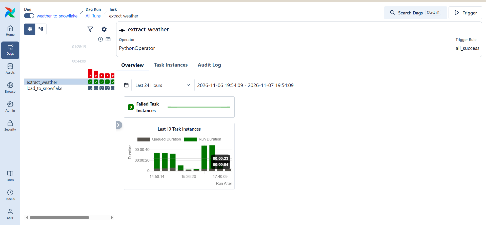

## What I learned

- Test a credential once, outside the scheduler, before letting retries hammer it.
- Row-by-row inserts do not scale. Stage the file, copy it in, and merge once.
- Give a pipeline its own user and role, and grant privileges one statement at a time.
- Put counts and tests at every layer, so a wrong number gets caught early.
- Use a measure for any number in a BI tool, not a raw column.

## What I would do next

- Run the DAG daily with a short lookback window instead of reloading a full year.
- Add failure alerts to the DAG.
- Refresh the Power BI report on a schedule.